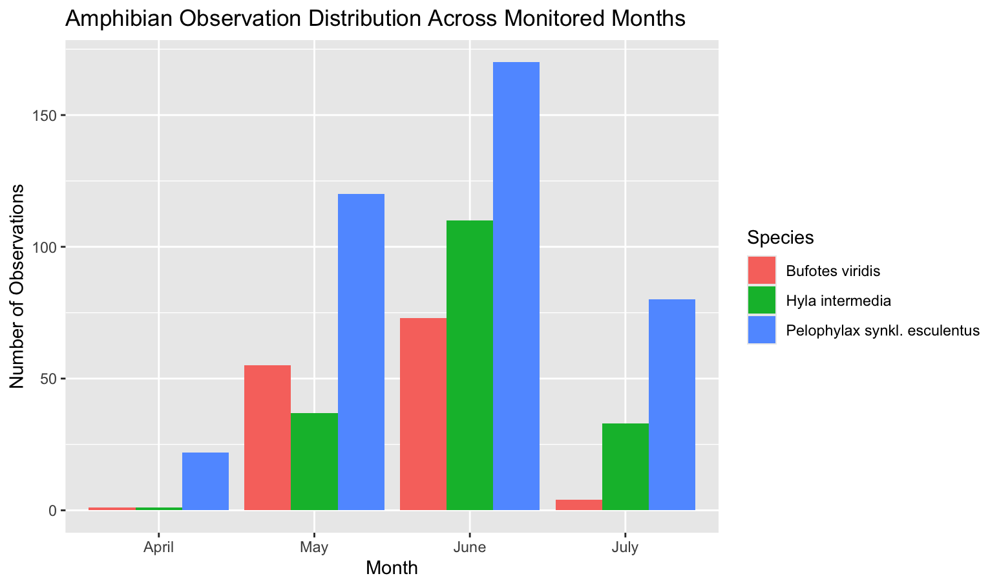

# Amphibian Road-Crossing Patterns: A Personal Dataset Project

## Project Overview:

This project investigates seasonal and daily patterns in amphibian road-crossing observations in northern Italy. Using observational data collected during 2021 and 2022, I aim to explore differences in recorded observations among three amphibian species.

The goal of this project is to use data visualization and statistical analysis to identify patterns in amphibian observations and explore how these patterns vary across species and time.

## Research Question:

How do seasonal and daily amphibian activity patterns vary among the three species observed at road-crossing locations in northern Italy?

The three species included in this analysis are *Pelophylax synkl. esculentus*, *Hyla intermedia*, and *Bufotes viridis*.

## Dataset:

The dataset, titled "Data from: Modelling amphibian road crossing points in a dynamic environment", was obtained from [Dryad](https://datadryad.org/dataset/doi%3A10.5061/dryad.cz8w9gjg2?).
The dataset contains amphibian occurrence observations collected in 2021 and 2022.

Variables include:
- `prg`: Observation identifier
- `lon`: Longitude
- `lat`: Latitude
- `spp`: Species identification
- `num`: Number of individuals observed
- `date`: Observation date
- `month`: Month of observation
- `year`: Year of observation
- `time`: Time of observation

## Data Processing and Cleaning

Before conducting my analysis, I cleaned and standardized the original dataset to ensure consistency across dates, times, species names, and coordinates.

My data cleaning process included the following steps:
- Date and time formatting: I converted the original date variable into R's Date format. I then standardized the time variable by replacing periods with colons, adding seconds where they were missing, and converting time values into a consistent character format. One row contained a missing time observation and was removed.
- Geographic filtering: I filtered the dataset to only include observations with latitude values between 40 and 50 and longitude values between 8 and 10; this ensured that the analysis focused on the intended study region in northern Italy. Two observations with extremely small latitudes (approximately 4.5) were removed.
- Species name standardization: I replaced abbreviated species codes with their full scientific names to make the dataset easier to interpret and visualize. The three species were standardized as *Pelophylax synkl. esculentus*, *Hyla intermedia*, and *Bufotes viridis*.
- Additional variable added: I extracted the month from the formatted date variable to create a new `month_name` variable to represent April, May, June, and July. This allowed me to easily group and compare observations by month in the subsequent visualization.

## Monthly Distribution of Amphibian Observations

The visualization above displays the number of recorded amphibian observations across four months (April-July), separated by species. I used a grouped bar chart to compare monthly observation frequencies for *Pelophylax synkl. esculentus*, *Hyla intermedia*, and *Bufotes viridis*; this allowed me to examine seasonal observation differences among the three species.

Several patterns stand out:
- June observation peak: All three species reach their highest recorded observation counts in June.
- Differences in observation frequency between species: *Pelophylax synkl. esculentus* is consistently the most frequently recorded species across all four months, while *Bufotes viridis* is consistently the least frequently recorded species across all four months. However, a conclusion that *Pelophylax synkl. esculentus* tend to be more active during these months, or that *Bufotes viridis* tend to be less active during these months, can't be made because the species' population sizes are not taken into account. There could be lots of large *Pelophylax synkl. esculentus* populations or a few small *Bufotes viridis* in the wild, and that would account for the sighting counts being higher or lower for each month.
- Decline in July observations: All three species experience a decrease in observations from June to July. This decline is especially drastic for *Bufotes viridis*.
- Low observation counts in April: April has very few observations across all three species, particularly compared to May and June. A majority of the observations in the dataset occurred in later in the summer period. 

Overall, the visualization illustrates that recorded amphibian observations were heavily concentrated in May and June, with June representing the peak month for observations for all three species. Although the species all seem to exhibit similar seasonal patterns from this visualization, I would like to analyze the count for each month relative to each species' population size, to see if a larger proportion of certain frog species tend to be more active.

## Citations:
Flego, Martino; Mangiacotti, Marco; Coladonato, Alan Jioele et al. (2025). Data from: Modelling amphibian road crossing points in a dynamic environment [Dataset]. Dryad. https://doi.org/10.5061/dryad.cz8w9gjg2.
